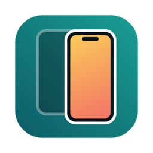
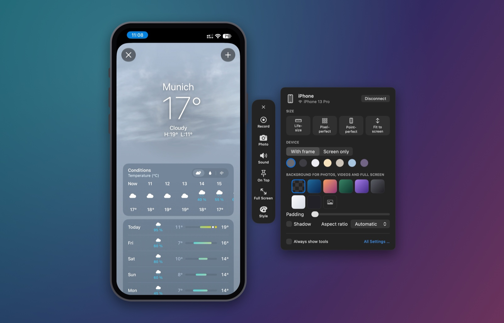
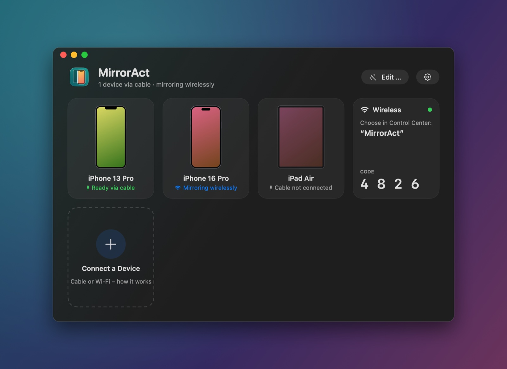
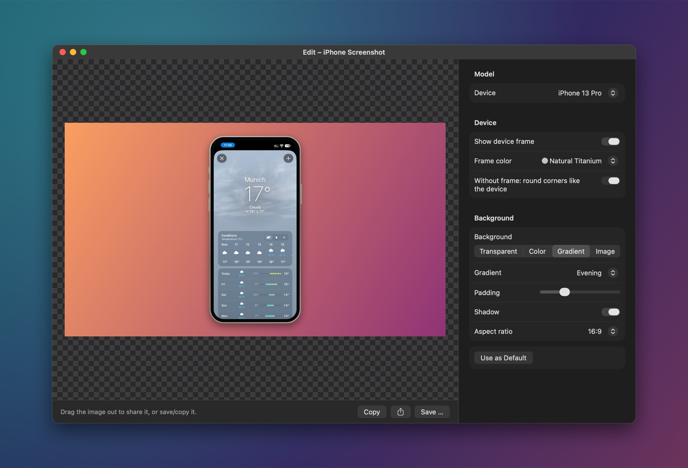
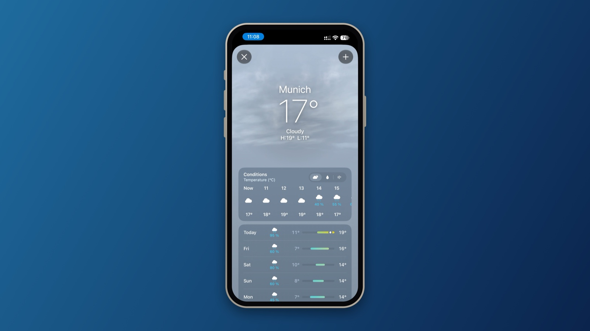
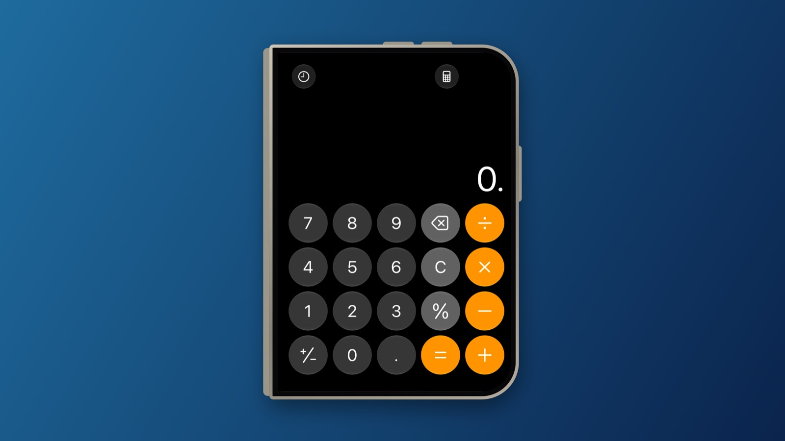
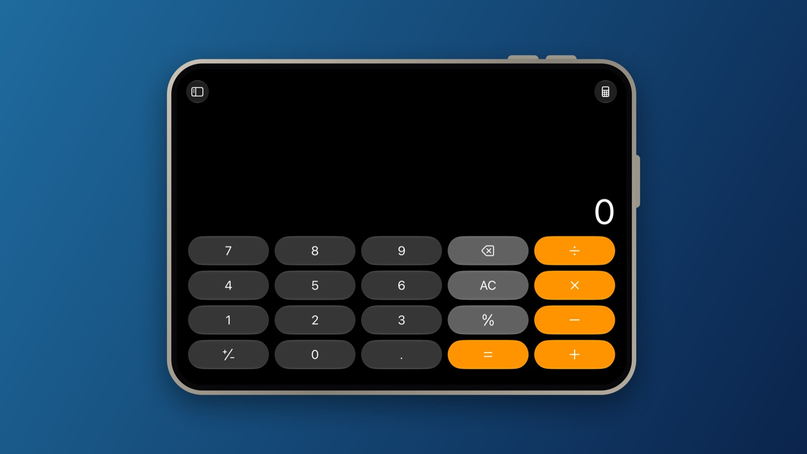
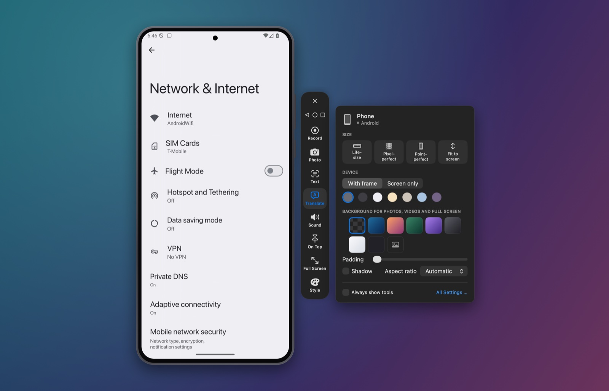
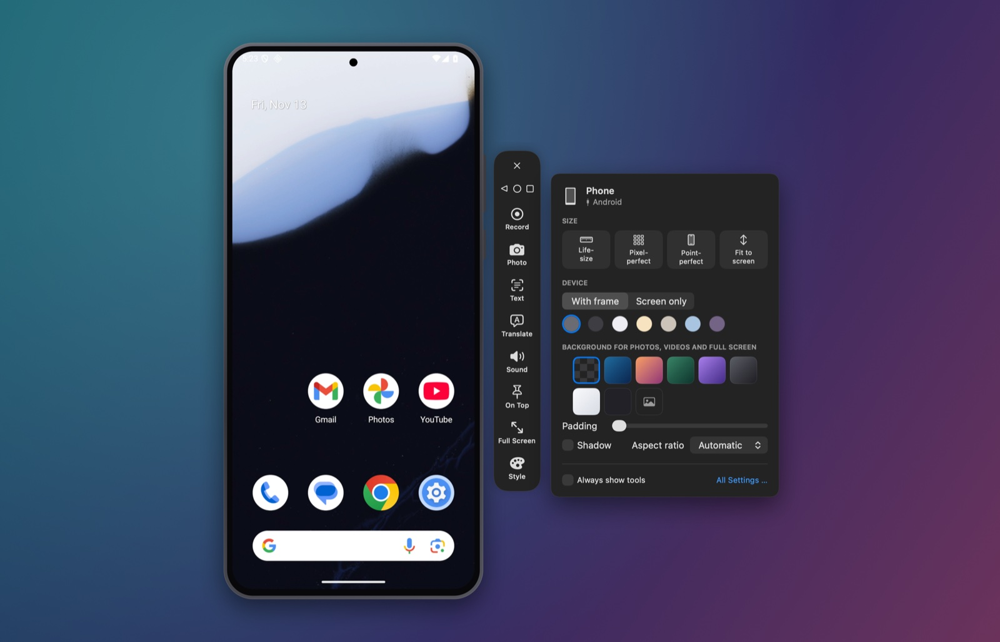

<p align="center"></p>

# MirrorAct

iPhone, iPad oder Android-Telefon auf dem Mac spiegeln, rahmen und aufnehmen – per Kabel oder kabellos.
Open Source, ohne Telemetrie: Alles bleibt auf deinem Mac, ausser du wählst zum Übersetzen einen
Online-Dienst.

*English: [README.md](README.md)*

<p align="center"></p>

## Warum

Apples *iPhone Mirroring* gibt es in der EU nicht; Apple begründet das mit dem Digital Markets
Act. Daher der Name. MirrorAct zeigt den Bildschirm von iPhone, iPad oder Android-Telefon im
Gerätrahmen auf dem Mac – für Demos, Präsentationen, Screenshots und Bildschirmaufnahmen.
Android-Telefone und, mit einem kleinen Test-Agent, auch iPhone und iPad lassen sich dabei mit Maus
und Tastatur bedienen.

## Loslegen

### 1. Installieren

Mit [Homebrew](https://brew.sh):

```bash
brew install --cask sopitz/tap/mirroract
```

Oder `MirrorAct-<version>.zip` unter [Releases](https://github.com/sopitz/MirrorAct/releases)
laden, entpacken und MirrorAct in den Ordner Programme ziehen. MirrorAct braucht macOS 15 oder
neuer auf einem Mac mit Apple Silicon. Die App ist mit einer Developer ID signiert und von Apple
notarisiert. Aktualisieren mit `brew upgrade --cask mirroract`.

### 2. Gerät verbinden

MirrorAct öffnen. Das Startfenster zeigt deine Geräte, den Code für kabellos und eine Anleitung
zum Verbinden.

- **iPhone oder iPad per Kabel:** Gerät anschliessen und entsperren, «Diesem Computer vertrauen» bestätigen, dann im Startfenster anklicken. Beim ersten Mal fragt macOS nach dem Kamerazugriff – so stellt macOS den Gerätebildschirm bereit.
- **iPhone oder iPad kabellos:** Auf dem Gerät Kontrollzentrum → Bildschirmsynchronisierung → «MirrorAct». Beim ersten Mal den Code aus dem Startfenster eingeben. Erscheint «MirrorAct» nicht, in macOS den AirPlay-Empfänger einschalten (Allgemein → AirDrop & Handoff).
- **Android-Telefon:** MirrorAct braucht adb, aus Homebrew (`brew install android-platform-tools`) oder aus dem Android-SDK (`~/Library/Android/sdk`). Einmalig USB-Debugging einschalten (Einstellungen → Telefoninfo → siebenmal auf «Build-Nummer» tippen, dann Einstellungen → Entwickleroptionen → USB-Debugging), Telefon anschliessen, auf dem Telefon «Zulassen» tippen und es im Startfenster anklicken. Für WLAN: Rechtsklick auf das Telefon im Startfenster → «WLAN statt Kabel verwenden» und danach das Kabel abziehen – ein offenes Fenster läuft über WLAN weiter –, oder ohne Kabel unter Gerät verbinden → Android koppeln (ab Android 11).

### 3. Rahmen, festhalten, präsentieren

Das Spiegelfenster zeigt nur das Gerät im Rahmen. Fährt die Maus darüber, erscheint daneben eine
Werkzeugleiste; ein Rechtsklick zeigt alle Funktionen.

- ⌘S macht einen Screenshot, ⌘R startet und beendet eine Aufnahme. Screenshots lassen sich direkt aus dem Fenster ziehen.
- ⌘K öffnet das Stil-Panel: Grösse, Rahmenfarbe, Hintergrund, Abstand, Schatten, Format.
- ⌃⌘F präsentiert das Gerät im Vollbild auf dem Hintergrund. Esc, nochmals ⌃⌘F oder «Präsentation beenden» oben links beenden es; der Knopf erscheint, sobald sich die Maus bewegt.
- ⌘E öffnet den Editor, für Screenshots und Aufnahmen, die du schon hast.

## Screenshots

| Startfenster | Editor |
|---|---|
|  |  |

**Ergebnis:** ein gerahmter Screenshot auf einem Verlauf, direkt aus dem Spiegelfenster



**iPhone Duo:** der Rahmen folgt dem Telefon, wenn es zu- oder aufgeklappt wird

| Zugeklappt | Aufgeklappt |
|---|---|
|  |  |

**Übersetzen:** ein Android-Telefon mit deutscher Einstellungen-App, auf Englisch gezeigt



Die Bilder zeigen die englische Oberfläche.

## Funktionen

- **Kabel (USB):** Bildabgriff wie bei QuickTime (CoreMediaIO, AVFoundation). Geringste Verzögerung, mit Ton.
- **Kabellos:** eigener AirPlay-Empfänger für die Bildschirmsynchronisierung. VideoToolbox dekodiert ohne Puffer, Ton inklusive. Neben dem WLAN bietet er sich auch über AWDL an (Apples Direktfunk), damit es auch klappt, wenn der Router Bonjour nicht weiterleitet.
- **Android:** über USB-Debugging, per Kabel oder WLAN, mit dem Server von [scrcpy](https://github.com/Genymobile/scrcpy) auf dem Telefon: Video ohne Puffer dekodiert, Ton ab Android 11, Bedienen mit Maus, Trackpad und Tastatur, Zwischenablage in beide Richtungen; siehe [Android-Telefon bedienen](#android-telefon-bedienen).
- **iPhone und iPad bedienen** (optional, für Entwickler): Maus, Trackpad und Tastatur über einen Test-Agent auf dem Gerät (WebDriverAgent), per Kabel oder kabellos; siehe [iPhone oder iPad bedienen](#iphone-oder-ipad-bedienen).
- **Gerätrahmen** pro Modell gezeichnet: Notch, Dynamic Island, Home-Button, iPad, iPhone Duo zu- und aufgeklappt, Android mit Kameraloch (Lage und Eckenradius liest MirrorAct vom Telefon), hoch und quer. Sieben Rahmenfarben.
- **Fenster ohne Leiste:** nur das Gerät auf dem Schreibtisch. Fährt die Maus darüber, erscheint daneben eine Werkzeugleiste: Aufnahme, Foto, Text, Übersetzen, Ton, Oben, Vollbild, Stil. Ein Rechtsklick zeigt alle Funktionen.
- **Immer im Vordergrund** (⌘T): das Spiegelfenster schwebt über anderen Fenstern. Mit «Auch über Vollbild-Apps» (Einstellungen → Allgemein, Menü «Gerät» oder Rechtsklick) erscheint es auch auf jedem Schreibtisch und über anderen Apps im Vollbild; ein Klick darauf holt MirrorAct dann nicht mehr nach vorn.
- **Stil-Panel:** Grösse (lebensgross, pixelgenau, punktgenau, Bildschirm füllen), Rahmen an/aus, Rahmenfarbe, Hintergrund (transparent, Verläufe, Farbe, Bild), Abstand, Schatten, Format (1:1, 16:9, 9:16, 4:3).
- **Screenshots und Aufnahmen** mit oder ohne Rahmen und Hintergrund. Mit transparentem Hintergrund entstehen PNG bzw. HEVC mit Alpha für Keynote und Schnittprogramme, sonst H.264. Screenshots lassen sich direkt aus dem Fenster ziehen.
- **Text auf dem Bildschirm:** «Text» kopiert den Text auf dem Gerätebildschirm in die Zwischenablage (Apples Vision, auf dem Mac). «Übersetzen» zeigt den Bildschirm in einer anderen Sprache, an Ort und Stelle und auch beim Scrollen, ebenso in Screenshots, Aufnahmen und beim Präsentieren. Übersetzt wird auf dem Mac (Apples Translation-Framework) oder von einem Sprachmodell-Dienst mit eigenem API-Schlüssel (OpenAI, Anthropic, Google Gemini, Mistral, xAI, DeepSeek, Groq, OpenRouter, Azure OpenAI, Ollama, LM Studio oder jeder OpenAI-kompatible Server); siehe [Text kopieren und übersetzen](#text-kopieren-und-übersetzen).
- **Präsentieren:** Gerät mittig auf dem Hintergrund, im Vollbild ohne Dock; die Menüleiste erscheint am oberen Rand. Beenden mit Esc, ⌃⌘F oder «Präsentation beenden» oben links.
- **Editor:** vorhandene Screenshots und Bildschirmaufnahmen nachträglich rahmen, Videos kürzen, zwei Screenshots als **Duo** (nebeneinander, versetzt, gekippt, perspektivisch).
- **Kurzbefehle:** «Screenshot einrahmen» (auch als Finder-Schnellaktion), «Screenshot vom iPhone», «Aufnahme starten oder beenden».

Die Oberfläche gibt es auf Englisch und Deutsch; die Sprache lässt sich unter Einstellungen → Allgemein wählen (Systemsprache, Deutsch, English).

## Tastatur und Einstellungen

⌘R Aufnahme, ⌘S Screenshot, ⇧⌘C Screenshot kopieren, ⌥⌘T Text kopieren, ⇧⌘T Übersetzen,
⌘K Stil-Panel, ⌃⌘F Präsentieren, ⌘T immer im Vordergrund, ⌘1 lebensgross, ⌘2 pixelgenau, ⌘0 punktgenau, ⌘E Editor.

Einstellungen unter MirrorAct → Einstellungen, das Log in `~/Library/Logs/MirrorAct.log`.

## Text kopieren und übersetzen

«Text» (⌥⌘T) kopiert den Text auf dem Gerätebildschirm in die Zwischenablage, einen Absatz pro
Zeile. «Übersetzen» (⇧⌘T) zeigt den Bildschirm in einer anderen Sprache, bis man es wieder
ausschaltet: Die Übersetzung wird über den Text gezeichnet, in der Grösse des Textes, den sie
ersetzt, bleibt beim Scrollen auf ihm und erscheint auch in Screenshots, Aufnahmen und beim
Präsentieren. Beide gibt es in der Werkzeugleiste und, als «Text auf dem Bildschirm kopieren» und
«Text auf dem Bildschirm übersetzen», im Kontextmenü und im Menü «Gerät». Beide lassen die
Statusleiste weg, auch im Querformat, und ein Zeichen wie «€» oder «#», das weit vor seinem Text
steht. Unter Einstellungen → Text:

- **Übersetzen nach:** die Systemsprache oder eine andere aus der Liste. Gibt es eine Sprache in
  mehreren Formen, nennt die Liste die Region, etwa «Deutsch (Schweiz)» oder «Englisch
  (Vereinigtes Königreich)», und die gewählte Form gilt. Mit «Systemsprache» nimmt «Dieser Mac»
  eine Form der eigenen Sprache, in die er übersetzen kann, am liebsten eine, die schon auf dem Mac
  ist.
- **Übersetzen mit:** «Dieser Mac (Apple)» oder «Sprachmodell-Dienst (eigener API-Schlüssel)»,
  unten beschrieben.
- **Dieser Mac (Apple):** Apples Translation-Framework, auf dem Mac und kostenlos. Wird ein
  Sprachpaar zum ersten Mal gebraucht, zeigt macOS einen Dialog mit beiden Sprachen und je einem
  Knopf zum Laden: dort laden und den Dialog mit «Fertig» schliessen. Bis dahin sagt das
  Spiegelfenster, worauf es wartet, und das Übersetzen beginnt von selbst, sobald die Sprachen auf
  dem Mac sind; das Laden kann eine Minute oder länger dauern. Fehlen die Sprachen 20 Sekunden nach
  dem Schliessen noch, sagt das Spiegelfenster, dass sie «noch nicht auf diesem Mac» sind: Laden
  sie noch, abwarten, sonst «Übersetzen» aus- und wieder einschalten, damit die Frage wiederkommt.
  «Übersetzen» auszuschalten schliesst auch einen offenen Dialog von macOS, ausser ein anderes
  Spiegelfenster übersetzt dieselben Sprachen. macOS wird jeweils nur nach einem Sprachpaar
  gefragt, und nur, wenn ein guter Teil des Textes auf dem Bildschirm in der Sprache ist: Ein Name,
  eine Seriennummer oder ein einzelnes Wort allein bringt die Frage nie. Einzelne Wörter wie «Ein»
  und «Aus» geraten unter Umständen falsch oder lauten von Bildschirm zu Bildschirm anders
  («Airplane mode» auf dem einen, «Flight mode» auf dem anderen). Einige Sprachen und regionale
  Formen, in der Liste markiert, brauchen Apple Intelligence; MirrorAct sagt es, wenn sie aus ist
  oder dieser Mac sie nicht unterstützt. Braucht die Sprache, in die übersetzt wird, Apple
  Intelligence, geht «Übersetzen» aus; Text in einer Sprache, die sie braucht, bleibt stehen.
- **Sprachmodell-Dienst (eigener API-Schlüssel):** den Dienst wählen, den eigenen API-Schlüssel
  eintragen («Schlüssel holen» öffnet die Seite des Dienstes dafür) und ein Modell; «Testen»
  übersetzt damit «Hello». Fehlen Adresse, ein nötiger API-Schlüssel oder ein Modell, geht
  «Übersetzen» nicht an, und das Fenster sagt, was zuerst einzutragen ist. Der Dienst kann jede
  Anfrage in Rechnung stellen, und je mehr neuer Text ins Bild kommt, solange «Übersetzen» an ist,
  desto mehr kostet es. Adresse und Modell gelten, sobald man Return drückt oder das Feld verlässt;
  ein unter «Modelle» gewähltes Modell gilt sofort. «Sichern» oder Return sichert den
  API-Schlüssel im Schlüsselbund, ebenso ein gelungenes «Testen». Braucht das Modell länger als
  eine Minute für eine Antwort (fünf Minuten für einen Server unter einer Adresse auf dem Mac oder
  im eigenen Netzwerk), sagt MirrorAct das und sendet weniger Texte pro Anfrage. Meldet der Dienst
  Fehler oder ist er nicht erreichbar, versucht MirrorAct es nach 5, 10, 20 und 40 Sekunden wieder
  und dann jede Minute, und das Spiegelfenster sagt es; sobald der Dienst wieder antwortet, wird
  der Bildschirm mit dem nächsten Versuch übersetzt, und «Übersetzen» aus- und wieder einschalten
  versucht es sofort. Eine Pause, um die der Dienst bittet (zu viele Anfragen), wird eingehalten,
  höchstens 15 Minuten. Antwortet das Modell in einer Form, die MirrorAct nicht brauchen kann, sagt
  das Fenster das und schlägt ein anderes Modell vor; «Übersetzen» bleibt an und versucht es nach
  denselben Wartezeiten wieder, zuerst mit einem einzelnen Text, bis das Modell richtig antwortet.
  «Übersetzen» geht aus, wenn der API-Schlüssel nicht angenommen wird oder dafür nicht verwendet
  werden darf, kein Guthaben mehr da ist, das Modell oder die Adresse falsch ist oder das Modell
  alles ablehnt, was es übersetzen soll.
- **Ein eigener Server** (Ollama, LM Studio oder Benutzerdefiniert): Einfaches `http://` geht für
  diesen Mac (`localhost`, `127.0.0.1`), für private IP-Adressen (`192.168.…`, `10.…`, `172.16.…`
  bis `172.31.…`), `.local`-Namen und Namen ohne Punkt; jede andere Adresse braucht `https://`.
  Eine Adresse ohne `http://` oder `https://` bekommt für diese `http://` und für jeden anderen
  Namen `https://`. Weiterleitungen folgt MirrorAct nicht, einzutragen ist also die Adresse, unter
  der der Server antwortet. Hat ein Server unter einer Adresse auf dem Mac oder im eigenen Netzwerk
  20 Sekunden lang nicht geantwortet, sagt es das Spiegelfenster («seit 20 s keine Antwort – lädt
  das Modell noch?»), bis die Antwort kommt. Nachdem das Modell einmal geantwortet hat, wartet das
  Spiegelfenster doppelt so lange wie die bisher langsamste Antwort, mindestens aber 20 Sekunden,
  bevor es das sagt. «Übersetzen» aus- und wieder einschalten sendet die Texte erneut.

**Was macOS fragt.** Mit «Dieser Mac» fragt macOS, bevor es ein Sprachpaar lädt; ein Paar braucht
einige hundert Megabyte auf dem Mac. Für einen Server auf einem anderen Computer im eigenen
Netzwerk fragt macOS, sofern es das noch nicht getan hat, ob MirrorAct sich mit Geräten im lokalen
Netzwerk verbinden darf; das erlauben, gleich oder später unter Systemeinstellungen → Datenschutz &
Sicherheit → Lokales Netzwerk. Fragt macOS, ob MirrorAct den API-Schlüssel im Schlüsselbund
verwenden darf, das erlauben; sonst bittet das Spiegelfenster, den Schlüssel erneut zu sichern.

«Text» und «Übersetzen» arbeiten Absatz für Absatz. Der Titel eines Listeneintrags und die graue
Zeile darunter (etwa in den Einstellungen) gelten als eigene Absätze: «Text» kopiert sie auf
getrennte Zeilen, «Übersetzen» übersetzt sie einzeln. Eine farbige Zeile, etwa ein Link oder eine
@-Erwähnung, bleibt Teil ihres Absatzes, ebenso ein farbiger Status unter einem Titel, etwa ein
grünes «Verbunden», ausser er steht weiter entfernt oder ist deutlich kleiner.

**Gut zu wissen:**

- «Text» kopiert alles, was es liest; so kann das Symbol eines Listeneintrags als ein oder zwei
  verirrte Buchstaben mitkommen. «Übersetzen» lässt solche Symbole in Ruhe und damit auch ein
  kurzes Wort an ihrer Stelle, etwa einen Wochentag vor zwei Zeilen Öffnungszeiten oder die
  Initialen in einem Profilbild: Es bleibt unübersetzt.
- Mit «Dieser Mac» bleibt ein einzelnes Wort in der Sprache des Geräts zwischen Text, der schon in
  der eigenen Sprache ist, unter Umständen stehen: Ein Wort allein verrät seine Sprache nicht.
- Text über einem laufenden Video, etwa Untertitel, wird nicht übersetzt, solange das Video läuft,
  und Text, der sich von selbst weiterbewegt, etwa ein Ticker oder ein Karussell, bleibt unter
  Umständen unübersetzt, solange er sich bewegt.
- Text, der sich ändert, während sich der Bildschirm bewegt, bekommt seine neue Übersetzung,
  sobald der Bildschirm zur Ruhe kommt. Eine Zeile, die eine Leiste oder der Bildschirmrand
  abschneidet, wird übersetzt, sobald sie ganz zu sehen ist, oder, unter einer Leiste, die stehen
  bleibt, so weit sie zu sehen ist, sobald der Bildschirm ruht; «Text» lässt eine Zeile weg, die
  der obere oder untere Bildschirmrand abschneidet.
- Solange ein Seitenpanel oder eine Schublade einen Teil der Seite verdeckt, werden die Wortenden
  daneben unter Umständen als kleine Beschriftungen übersetzt, und eine Zeile, die zur Hälfte
  hinter einer Leiste liegt, kann in «Text» und «Übersetzen» als einige verstümmelte Buchstaben
  erscheinen.
- Eine Übersetzung, die nicht an den Platz ihres Textes passt, wird kleiner gesetzt, und eine, die
  auch dann nicht passt, endet mit Auslassungspunkten.
- In sehr kleiner Schrift, etwa bei einem Telefon, das in niedriger Auflösung gespiegelt wird, wird
  eine fette, eine in Grossbuchstaben oder eine arabische Zeile unter Umständen vom Rest ihres
  Absatzes getrennt: «Übersetzen» übersetzt sie für sich, «Text» kopiert sie auf eine eigene
  Zeile.

Trennt sich das Gerät, geht «Übersetzen» aus und muss wieder eingeschaltet werden. Wechselt
MirrorAct ein Android-Fenster selbst auf die andere Verbindung (Kabel abgezogen bei bestehendem
WLAN oder umgekehrt, oder «WLAN statt Kabel verwenden»), geht «Übersetzen» wieder an, wenn das neue
Bild innert 10 Sekunden kommt, und bleibt sonst aus; das Fenster sagt, was davon gilt, und ein
Klick auf «Übersetzen» in dieser Zeit lässt es aus.

## Android-Telefon bedienen

Sobald ein Android-Telefon gespiegelt wird, bedient das Spiegelfenster es:

<p align="center"></p>

- Klick: tippen, Ziehen: wischen (der Finger folgt der Maus live), ⌘-Ziehen verschiebt das Fenster
- Trackpad oder Mausrad: scrollen, Mittelklick: Home
- Tippen geht ans Telefon, auch Umlaute und andere Zeichen; Esc ist Zurück, ⌘V fügt die Zwischenablage des Macs ein, auf dem Telefon kopierter Text landet in der Zwischenablage des Macs
- Zurück, Home und Letzte Apps in der Werkzeugleiste, in Reihenfolge und Aussehen der Navigationsleiste des Telefons (Samsung: Letzte Apps, Home, Zurück); Mitteilungen, Lautstärke, Bildschirm ein/aus und Drehen im Kontextmenü

Dauerhaft installiert wird nichts: Während der Spiegelung läuft der scrcpy-Server aus einer
temporären Datei auf dem Telefon und endet, wenn das Fenster geschlossen wird. Ton gibt es ab
Android 11; er spielt dann auf dem Mac statt auf dem Telefon. Apps, die ihre Inhalte schützen
(Banking, Streaming), bleiben schwarz.

## iPhone oder iPad bedienen

Optional, für Entwickler: Mit einem kleinen Test-Agent auf dem Gerät gibt MirrorAct Klicks, Ziehen,
Scrollen und Tippen an das iPhone oder iPad weiter. iOS erlaubt das nur für UI-Tests, deshalb geht
MirrorAct den Weg, auf dem Xcode Apps automatisiert:
[WebDriverAgent](https://github.com/appium/WebDriverAgent) (aus dem Appium-Projekt) läuft als
UI-Test auf dem Gerät und wird mit `xcodebuild` gestartet.

Dafür braucht es:

- Xcode in einer Version, die die iOS-Version des Geräts unterstützt
- ein Apple-Entwicklerteam (eine kostenlose Apple-ID geht auch, die Signatur läuft aber nach 7 Tagen ab)
- auf dem Gerät: **Entwicklermodus** (Einstellungen → Datenschutz & Sicherheit → Entwicklermodus; das Gerät startet neu) und danach unter Einstellungen → Entwickler die **UI-Automatisierung**

Dieses Repository klonen, `Config/Local.xcconfig.example` nach `Config/Local.xcconfig` kopieren und
die eigene Team-ID als `DEVELOPMENT_TEAM` eintragen. Dann den Agent einmal bauen (erneut nach einem
Wechsel von Team oder Xcode-Version). Das geht auch mit MirrorAct aus Homebrew; es braucht nur
Xcode, nicht die Pakete, mit denen MirrorAct selbst gebaut wird:

```bash
scripts/build-agent.sh
```

Er wird mit dem eigenen Team signiert und liegt dann in
`~/Library/Application Support/MirrorAct/Agent`. Ist das Gerät noch nicht im Team registriert, es
anschliessen und seine Kennung aus Xcode → Devices and Simulators mitgeben:
`scripts/build-agent.sh --device <UDID>`.

Die Bedienung startet von selbst, sobald das Gerät verbunden ist; der Agent braucht auf dem Gerät
einige Sekunden. Klappt das nicht, etwa weil das Gerät gesperrt ist, bleibt in der Werkzeugleiste
der Knopf **Bedienen**; ein Klick darauf (oder Gerät → Gerät bedienen, ⌥⌘C) prüft erneut und sagt,
was fehlt. Wer die Bedienung nur bei Bedarf will, schaltet unter MirrorAct → Einstellungen →
Allgemein «Bedienung beim Verbinden starten» aus. Nach dem Ausschalten oder Schliessen des Fensters
läuft der Agent noch fünf Minuten auf dem Gerät weiter, damit die Bedienung sofort wieder da ist;
beim Beenden von MirrorAct wird er gestoppt. Endet eine kabellose Verbindung (auf dem Gerät, mit
**Trennen** oder durch Schliessen des Fensters), stoppt der Agent sofort. Danach:

- Klick: Tippen, Halten: langes Drücken, Ziehen: Wischen
- Trackpad oder Mausrad: Scrollen (den Schwung ergänzt iOS selbst)
- Tippen geht in das aktive Textfeld, ⌘V tippt den Text aus der Zwischenablage des Macs
- Home, App-Umschalter, Mitteilungszentrale, Lautstärke und Sperren in der Werkzeugleiste und im Kontextmenü

Das geht per Kabel und kabellos; MirrorAct erreicht den Agent über usbmuxd (wie Xcode) oder über das
lokale Netzwerk. Gesten werden beim Loslassen der Maustaste geschickt, der Finger folgt der Maus also
nicht live. Ein Gerät mit Code lässt sich so nicht entsperren. Die Ausgabe von `xcodebuild` steht in
`~/Library/Logs/MirrorAct-Agent.log`.

## Datenschutz

MirrorAct arbeitet lokal und hat keine Telemetrie. Daten sendet es nur, wenn man für «Übersetzen»
einen Sprachmodell-Dienst wählt (siehe unten). Netzwerkzugriff gibt es nur für den
AirPlay-Empfänger im lokalen Netzwerk und über AWDL, für adb zu Android-Telefonen (per Kabel oder,
bei WLAN, im lokalen Netzwerk), während ein iPhone oder iPad bedient wird zum Agent auf diesem
Gerät, und zu diesem Dienst.

Die Texterkennung läuft auf dem Mac, und «Text» kopiert nur in die Zwischenablage. Auch
«Übersetzen» läuft standardmässig auf dem Mac («Dieser Mac»): Nichts vom Bildschirm verlässt ihn,
und die Sprachen lädt macOS von Apple, sobald man zustimmt. Nur wer unter Einstellungen → Text
einen Sprachmodell-Dienst wählt, sendet den auf dem Bildschirm erkannten Text an diesen Dienst –
den Text, nicht das Bild –, mit dem eigenen API-Schlüssel und nur, solange «Übersetzen» an ist;
beim Einschalten mit einem Dienst ausserhalb des eigenen Netzwerks sagt das Spiegelfenster, wohin
der Text geht. Was der Dienst damit tut, regeln seine Bedingungen. «Testen» sendet das Wort
«Hello», und «Liste laden» fragt den Dienst nach seinen Modellen. Ein eigener Server unter einer
Adresse auf dem Mac oder im eigenen Netzwerk (Ollama, LM Studio, Benutzerdefiniert) behält den Text
dort. Der API-Schlüssel bleibt im Schlüsselbund und geht nur an diesen Dienst, mit dessen Anfragen.

## Rechtliches

MirrorAct steht in keiner Verbindung zu Apple Inc. iPhone, iPad, AirPlay und macOS sind Marken
von Apple Inc. Der kabellose Empfang nutzt die unabhängige AirPlay-Umsetzung des Projekts
[UxPlay](https://github.com/FDH2/UxPlay). Geschützte Inhalte (z. B. aus Streaming-Apps) sperrt
iOS; sie lassen sich nicht spiegeln.

Android ist eine Marke von Google LLC; MirrorAct steht in keiner Verbindung zu Google. Die
Android-Spiegelung nutzt den Server des Projekts [scrcpy](https://github.com/Genymobile/scrcpy)
von Genymobile.

## Rückmeldungen und Mitarbeit

Einen Fehler gefunden oder fehlt etwas? Dafür gibt es die [Issues](https://github.com/sopitz/MirrorAct/issues).
Wer MirrorAct selbst bauen oder daran mitarbeiten will – aus dem Quellcode bauen, Aufbau des Codes,
Branches und Releases –, findet alles in [CONTRIBUTING.de.md](CONTRIBUTING.de.md).

## Unterstützen

MirrorAct ist kostenlos. Wenn dir die App Zeit spart, kannst du mir [einen Kaffee spendieren](https://buymeacoffee.com/sopitz).

[](https://buymeacoffee.com/sopitz)

## Lizenz

GPL-3.0-or-later, siehe [LICENSE](LICENSE). Fremdkomponenten: [THIRD_PARTY_NOTICES.md](THIRD_PARTY_NOTICES.md).
