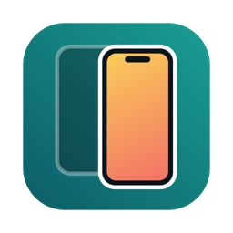
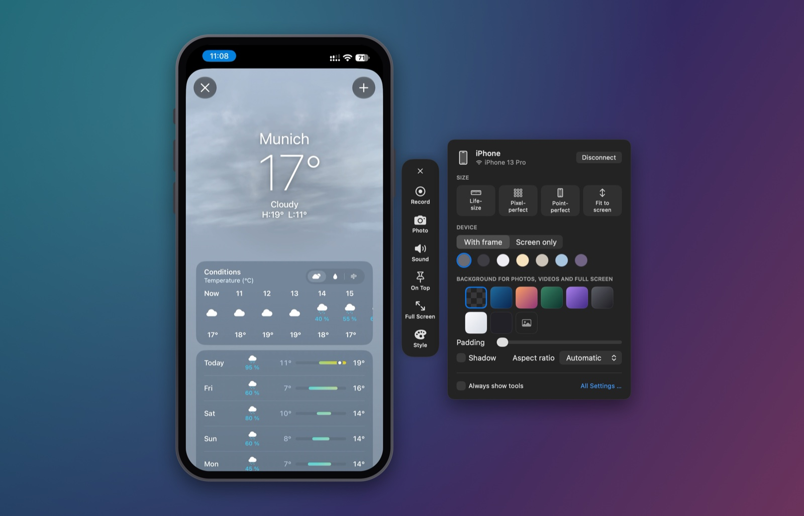
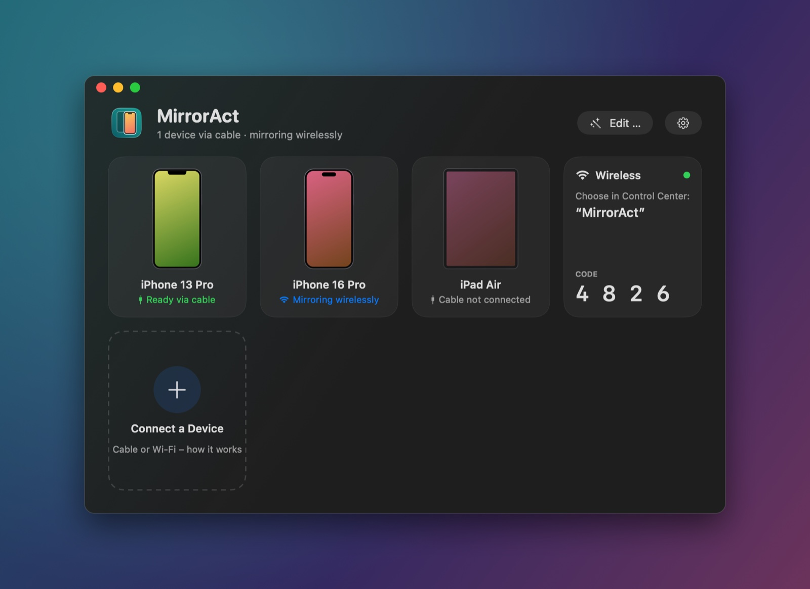
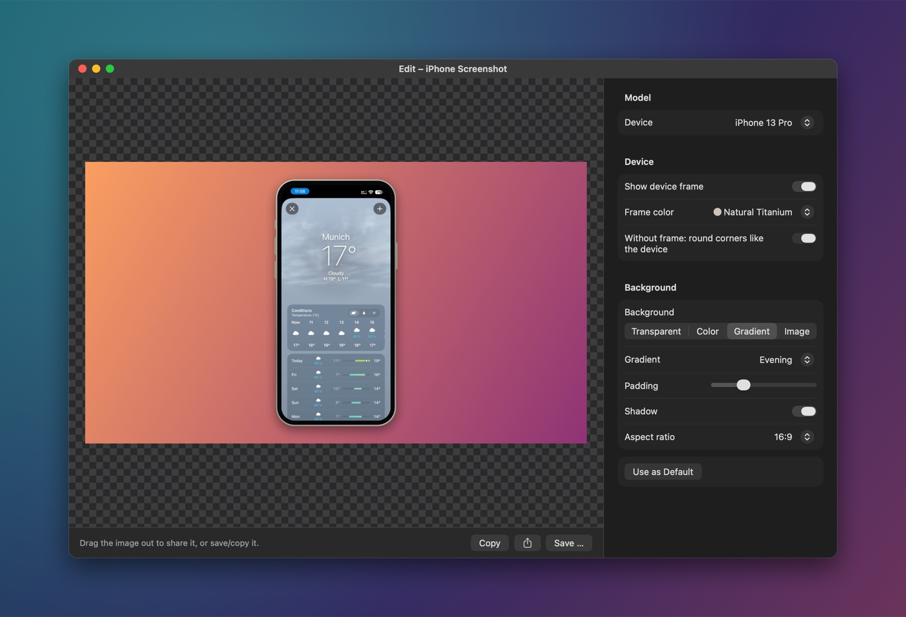
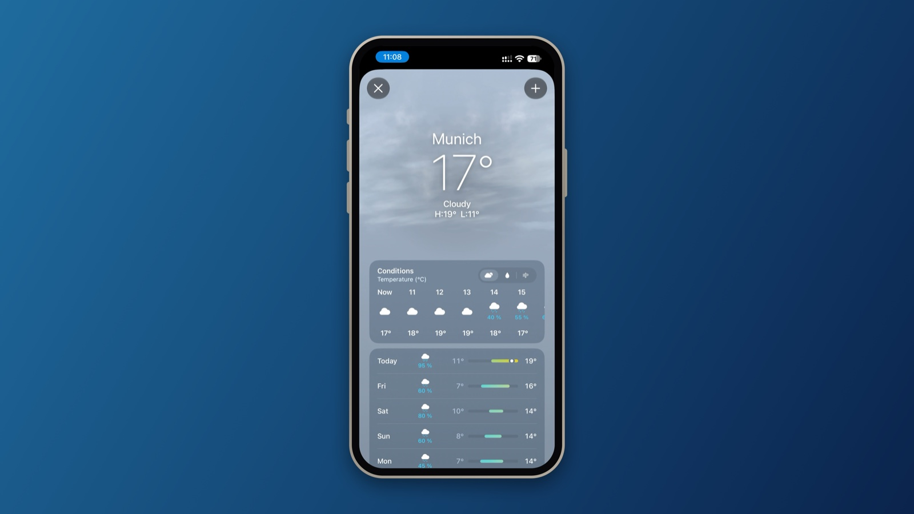
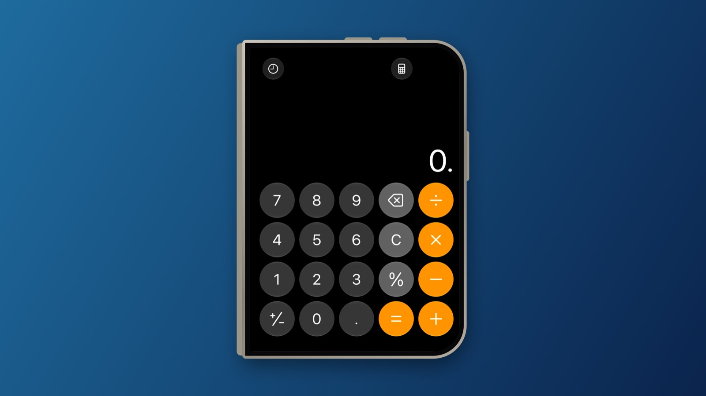
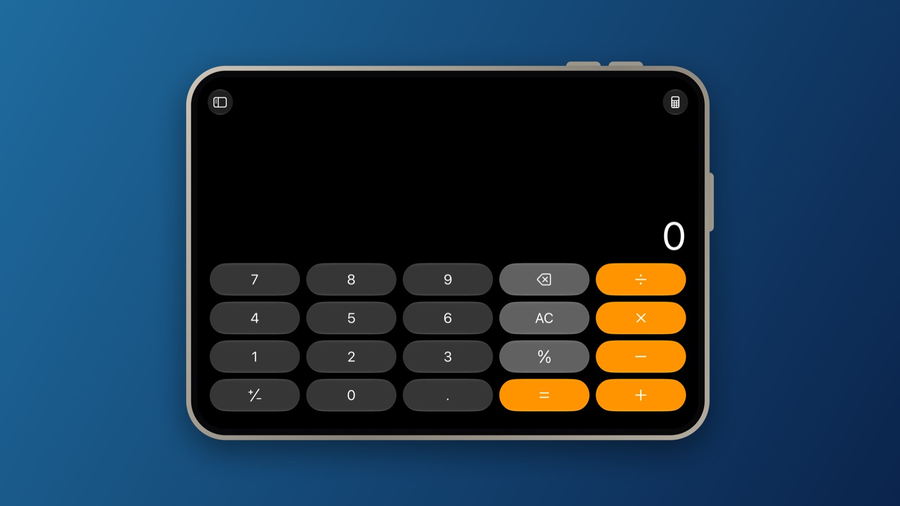
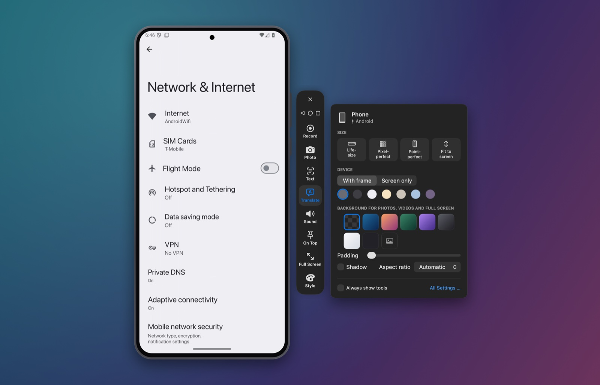
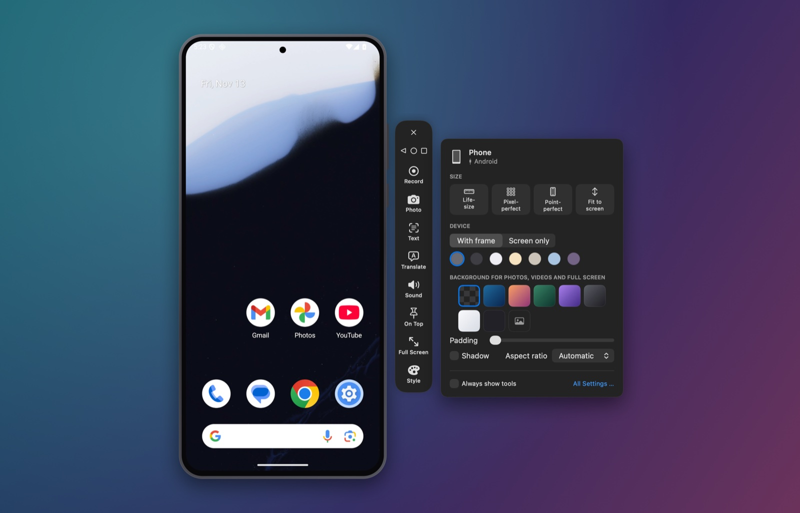

<p align="center"></p>

# MirrorAct

Mirror, frame and record your iPhone, iPad or Android phone on your Mac – over a cable or wirelessly.
Open source, no telemetry: everything stays on your Mac unless you choose an online service for
translating.

*Deutsch: [README.de.md](README.de.md)*

<p align="center"></p>

## Why

Apple's *iPhone Mirroring* is not available in the EU; Apple cites the Digital Markets Act.
MirrorAct is named after that gap. It shows the screen of your iPhone, iPad or Android phone on
your Mac in a device frame – for demos, presentations, screenshots and screen recordings. Android
phones and, with a small test agent, iPhones and iPads can also be controlled with mouse and
keyboard.

## Get started

### 1. Install

With [Homebrew](https://brew.sh):

```bash
brew install --cask sopitz/tap/mirroract
```

Or download `MirrorAct-<version>.zip` from [Releases](https://github.com/sopitz/MirrorAct/releases),
unzip it and move MirrorAct to Applications. MirrorAct needs macOS 15 or later on a Mac with Apple
silicon. It is signed with a Developer ID and notarized by Apple. Update with
`brew upgrade --cask mirroract`.

### 2. Connect a device

Open MirrorAct. The start window shows your devices, the code for wireless mirroring and a guide
for connecting a device.

- **iPhone or iPad by cable:** connect and unlock the device, confirm "Trust This Computer", then click it in the start window. On first use, macOS asks for camera access – that is how macOS provides the device screen.
- **iPhone or iPad wirelessly:** on the device, open Control Center → Screen Mirroring → "MirrorAct". The first time, enter the code shown in the start window. If "MirrorAct" does not appear, turn on AirPlay Receiver in macOS (General → AirDrop & Handoff).
- **Android phone:** MirrorAct needs adb, from Homebrew (`brew install android-platform-tools`) or from the Android SDK (`~/Library/Android/sdk`). Turn on USB debugging once (Settings → About phone → tap "Build number" seven times, then Settings → Developer options → USB debugging), connect the phone, tap "Allow" on the phone and click it in the start window. For Wi-Fi, right-click the phone in the start window → "Use Wi-Fi Instead of Cable" and then unplug the cable – an open window continues over Wi-Fi – or pair it without a cable under Connect a Device → Android (Android 11 or later).

### 3. Frame, capture, present

The mirror window shows only the device in its frame. Move the mouse over it and a tool rail
appears next to it; right-click shows every function.

- ⌘S takes a screenshot, ⌘R starts and stops a recording. Drag screenshots straight out of the window.
- ⌘K opens the style panel: size, frame color, background, padding, shadow, aspect ratio.
- ⌃⌘F presents the device full screen on your background. Esc, ⌃⌘F again or "Exit Presentation" at the top left end it; the button shows up when you move the mouse.
- ⌘E opens the editor, for screenshots and recordings you already have.

## Screenshots

| Start window | Editor |
|---|---|
|  |  |

**Result:** a framed screenshot on a gradient, exported from the mirror window



**iPhone Duo:** the frame follows the phone when it is folded or unfolded

| Closed | Open |
|---|---|
|  |  |

**Translate:** an Android phone whose Settings app is in German, shown in English



## Features

- **Cable (USB):** captures the screen the way QuickTime does (CoreMediaIO, AVFoundation). Lowest latency, with audio.
- **Wireless:** built-in AirPlay screen mirroring receiver. Decoding with VideoToolbox without buffering, audio included. Besides the local network it also advertises itself over AWDL (Apple's peer-to-peer Wi-Fi), so it works when the router does not forward Bonjour.
- **Android:** over USB debugging, by cable or Wi-Fi, with the [scrcpy](https://github.com/Genymobile/scrcpy) server on the phone: video decoded without buffering, sound from Android 11, control with mouse, trackpad and keyboard, clipboard in both directions; see [Controlling an Android phone](#controlling-an-android-phone).
- **iPhone and iPad control** (optional, for developers): mouse, trackpad and keyboard through a test agent on the device (WebDriverAgent), by cable or wirelessly; see [Controlling an iPhone or iPad](#controlling-an-iphone-or-ipad).
- **Device frames** drawn for each model: notch, Dynamic Island, home button, iPad, iPhone Duo closed and open, Android with punch-hole camera (position and corner radius read from the phone), portrait and landscape. Seven frame colors.
- **Window without chrome:** only the device on your desktop. A tool rail appears next to it on hover: Record, Photo, Text, Translate, Sound, On Top, Full Screen, Style. Right-click shows every function.
- **Keep on top** (⌘T): the mirror window floats above other windows. With "Also above full-screen apps" (Settings → General, the Device menu or right-click) it also shows on every desktop and above other apps in full screen; clicking it then no longer brings MirrorAct to the front.
- **Style panel:** size (life-size, pixel-perfect, point-perfect, fit), frame on/off, frame color, background (transparent, gradients, color, image), padding, shadow, aspect ratio (1:1, 16:9, 9:16, 4:3).
- **Screenshots and recordings** with or without frame and background. Transparent backgrounds produce PNG or HEVC with alpha for Keynote and video editors, otherwise H.264. Drag screenshots straight out of the window.
- **Text on the screen:** "Text" copies the text on the device screen to the clipboard (Apple's Vision, on your Mac). "Translate" shows the screen in another language, in place and while you scroll, in screenshots, recordings and the presentation too. It translates on your Mac (Apple's Translation framework) or with a language model service and your own API key (OpenAI, Anthropic, Google Gemini, Mistral, xAI, DeepSeek, Groq, OpenRouter, Azure OpenAI, Ollama, LM Studio or any OpenAI-compatible server); see [Copying and translating text](#copying-and-translating-text).
- **Presentation mode:** device centered on your background, full screen, without Dock; the menu bar slides in at the top edge. End it with Esc, ⌃⌘F or "Exit Presentation" at the top left.
- **Editor:** frame existing screenshots and screen recordings afterwards, trim videos, two screenshots as a **duo** (side by side, staggered, tilted, perspective).
- **Shortcuts:** "Frame screenshot" (usable as a Finder Quick Action), "Screenshot from iPhone", "Start or stop recording".

The user interface is available in English and German; choose the language under Settings → General (System language, Deutsch, English).

## Keyboard and settings

⌘R record, ⌘S screenshot, ⇧⌘C copy screenshot, ⌥⌘T copy text, ⇧⌘T translate, ⌘K style panel,
⌃⌘F present, ⌘T keep on top, ⌘1 life-size, ⌘2 pixel-perfect, ⌘0 point-perfect, ⌘E editor.

Settings live under MirrorAct → Settings, the log in `~/Library/Logs/MirrorAct.log`.

## Copying and translating text

"Text" (⌥⌘T) copies the text on the device screen to the clipboard, one paragraph per line: the
device's own text, also while "Translate" is on. "Translate" (⇧⌘T) shows the screen in another
language until you turn it off: the translation is drawn over the text, in the size of the text it
replaces, stays on it while you scroll, and shows in screenshots, recordings and the presentation
too. Both are in the tool rail, and in the context menu and the Device menu as "Copy Text on Screen"
and "Translate Text on Screen". Both leave out the status bar, in landscape too, and a sign such as
"€" or "#" set far apart in front of its text. Under Settings → Text:

- **Translate into:** the system language or another one from the list. Where a language comes in
  several forms, the list names the region, such as "German (Switzerland)" or "English (United
  Kingdom)", and the form you choose is used. With "System language", "This Mac" uses a form of
  your language that it can translate into, preferably one already on the Mac.
- **Translate with:** "This Mac (Apple)" or "Language model service (own API key)", described
  below.
- **This Mac (Apple):** Apple's Translation framework, on your Mac and free of charge. The first
  time a pair of languages is needed, macOS shows a panel that lists both with a download button
  each: download them there and close the panel with Done. Meanwhile the mirror window says what it
  waits for, and translating starts by itself once the languages are on the Mac; a download can
  take a minute or more. If the languages are still missing 20 seconds after the panel was closed,
  the window says that they "aren’t on this Mac yet": wait if they are still downloading, otherwise
  turn "Translate" off and on to bring the question back. Turning "Translate" off also closes an
  open panel, unless another mirror window is translating the same languages. macOS is asked about
  one pair at a time, and only when a fair amount of the text on the screen is in the language: a
  name, a serial number or a single word alone never brings up the question. Single words and
  short labels may come out wrong or odd, or differently from one screen to the next ("Airplane
  mode" on one, "Flight mode" on another). Some languages and regional forms, marked in the list,
  need Apple Intelligence; MirrorAct says so when it is off or this Mac does not support it. If the
  language you translate into needs it, "Translate" turns off; text in a language that needs it
  stays as it is.
- **Language model service (own API key):** choose the service, enter your API key ("Get a key"
  opens the service's page for one) and a model; Test translates "Hello" with them. Without an
  address, an API key the service needs, or a model, "Translate" does not turn on, and the window
  says what to enter first. The service may charge your account for each request, and the more new
  text comes into view while "Translate" is on, the more it costs. Address and Model take effect
  when you press Return or leave the field; a model chosen from Models takes effect at once. Save
  or Return stores the API key in your keychain, and so does a Test that works. If the model takes
  longer than a minute to answer (five minutes for a server at an address on your Mac or in your
  network), MirrorAct says so and sends fewer texts per request. If the service reports errors or
  cannot be reached, MirrorAct tries again after 5, 10, 20 and 40 seconds and then every minute;
  the mirror window names the error and, once the wait is a minute, when it tries again. Once the
  service answers again, the screen is translated with the next try, so up to a minute later, and
  turning "Translate" off and on tries at once. A pause the service asks for (too many requests) is
  kept, up to 15 minutes. If the model answers in a form MirrorAct cannot use, the window says so
  and suggests another model; "Translate" stays on and tries again after the same waits, starting
  with a single text, until the model answers properly. "Translate" turns off when the API key is
  not accepted or may not be used for this, the account has no credit left, the model or the
  address is wrong, or the model declines everything it is asked to translate.
- **A server of your own** (Ollama, LM Studio or Custom): plain `http://` works for this Mac
  (`localhost`, `127.0.0.1`), for private IP addresses (`192.168.…`, `10.…`, `172.16.…` to
  `172.31.…`), `.local` names and names without a dot; any other address needs `https://`. An
  address typed without `http://` or `https://` gets `http://` for these and `https://` for any
  other name. MirrorAct does not follow redirects, so enter the address the server answers at. When
  a server at an address on this Mac or in your network has not answered for 20 seconds, the
  mirror window says so ("no answer for 20 s – is the model still loading?") until the answer
  comes. Once the model has answered, the window waits twice as long as the slowest answer so far,
  and at least 20 seconds, before it says so. Turning "Translate" off and on sends the texts again.

**What macOS asks.** With "This Mac", macOS asks before it downloads a pair of languages, which
takes several hundred megabytes on the Mac. For a server on another computer in your network,
macOS asks whether MirrorAct may connect to devices on your local network, if it has not asked
before; allow it, then or later under System Settings → Privacy & Security → Local Network. If
macOS asks whether MirrorAct may use the API key in your keychain, allow it; otherwise the mirror
window asks you to store the key again.

Text and Translate work paragraph by paragraph. The title of a list entry and the gray line under
it (in settings, for example) count as separate paragraphs: Text copies them on separate lines,
and Translate translates them separately. A colored line, such as a link or an @mention, stays
part of its paragraph, and so does a colored status under a title, such as a green "Connected",
unless it lies farther away or is clearly smaller.

**Good to know:**

- Text copies everything it reads, so the icon of a list row can come along as a stray letter or
  two. Translate leaves such icons alone, and with them a short word in their place, such as a
  weekday in front of two lines of opening hours or the initials in an avatar, which stays
  untranslated. A short word set apart in a column of its own beside its text, such as a quantity
  in front of an item, is copied on a line of its own and translated on its own.
- With "This Mac", a single word in the device's language among text already in your language may
  stay as it is: one word alone does not tell its language.
- When a number changes in a short line, such as a counter or a storage summary, the line's
  translation disappears for a moment until the line has been read and translated again, instead
  of showing the old number; in a paragraph of several lines the old translation can stay for
  a few seconds. A number that changes every second or faster therefore shows untranslated much
  of the time, and with a language model service every new value is sent to be translated. In a
  list whose rows differ only by a number, translations can vanish while the list scrolls fast and
  come back when it stops. Now and then a line with a number stays untranslated after it changed
  or after a list stopped, until the page moves or the screen changes.
- Once the screen has come to rest, it is read a few more times and then not again until
  something on it changes; what keeps changing, such as a clock with seconds, is read again with
  each change. A blinking cursor in a text field has its line read again at about every blink.
- Text over a playing video, such as subtitles, is not translated while the video plays, and text
  that keeps moving by itself, such as a ticker or a carousel, may stay untranslated while it
  moves; a ticker that never stops keeps the Mac busy (about half a processor core) for as long as
  it runs.
- Text that changes while the screen moves gets its new translation once the screen comes to rest.
  A line that a bar or the edge of the screen cuts off is translated once all of it shows, or,
  under a bar that stays, as far as it shows once the screen rests; "Text" leaves out a line cut
  off at the top or bottom edge of the screen. When a keyboard or a sheet slides away, a line it
  covered can stay untranslated until the page moves, and so can the first paragraph under a title
  bar after the page was pulled past its top end.
- Now and then, after fast scrolling, a paragraph stays translated line by line or in two pieces
  until the page moves.
- While a side panel or drawer covers part of a page, the ends of words that show beside it may be
  translated as small labels, and a line half hidden behind a bar can come out as a few garbled
  letters in Text and in Translate.
- A translation that does not fit in the place of its text is set smaller, and one that still
  does not fit ends with an ellipsis. A short label can also come out a little smaller than the
  text beside it.
- In very small text, such as a phone mirrored at a low resolution, a bold, an all-caps or an
  Arabic line may be taken apart from the rest of its paragraph: Translate translates it on its
  own, and Text copies it on a line of its own.
- Where a line that should be translated stays untranslated on a still screen, scrolling a little,
  or turning "Translate" off and on, has it read and translated again.

When the device disconnects, "Translate" turns off; turn it on again. When MirrorAct itself moves
an Android window to the other connection (the cable unplugged while Wi-Fi is there or the other
way round, or "Use Wi-Fi Instead of Cable"), "Translate" goes on again if the new picture arrives
within 10 seconds and stays off otherwise; the window says which, and pressing "Translate"
meanwhile keeps it off.

## Controlling an Android phone

As soon as an Android phone is mirrored, the mirror window controls it:

<p align="center"></p>

- click: tap, drag: swipe (the finger follows the mouse live), ⌘-drag moves the window
- trackpad or mouse wheel: scroll, middle click: Home
- typing goes to the phone, including umlauts and other characters; Esc is Back, ⌘V pastes the Mac clipboard, text copied on the phone lands in the Mac clipboard
- Back, Home and Recent Apps are in the tool rail, in the order and look of the phone's navigation bar (Samsung: Recent Apps, Home, Back); notifications, volume, screen on/off and rotation in the context menu

Nothing is installed permanently: while mirroring, the scrcpy server runs from a temporary file on
the phone and ends when the window is closed. Sound needs Android 11 or later and plays on the Mac
instead of the phone. Apps that protect their content (banking, streaming) stay black.

## Controlling an iPhone or iPad

Optional, for developers: with a small test agent on the device, MirrorAct passes clicks, drags,
scrolling and typing on to the iPhone or iPad. iOS allows this only for UI tests, so MirrorAct
does it the way Xcode automates apps: [WebDriverAgent](https://github.com/appium/WebDriverAgent)
(from the Appium project) runs as a UI test on the device, started with `xcodebuild`.

You need:

- Xcode in a version that supports the iOS version of the device
- an Apple developer team (a free Apple ID works too, but its signature expires after 7 days)
- on the device: **Developer Mode** (Settings → Privacy & Security → Developer Mode; the device restarts) and, afterwards, **Enable UI Automation** under Settings → Developer

Clone this repository, copy `Config/Local.xcconfig.example` to `Config/Local.xcconfig` and enter
your team ID as `DEVELOPMENT_TEAM`. Then build the agent once (again after a change of team or
Xcode version). This works with MirrorAct from Homebrew too; it needs only Xcode, not the packages
for building MirrorAct itself:

```bash
scripts/build-agent.sh
```

It is signed with your team and placed in `~/Library/Application Support/MirrorAct/Agent`. If the
device is not yet registered with your team, connect it and pass its identifier from Xcode →
Devices and Simulators: `scripts/build-agent.sh --device <UDID>`.

Control starts by itself as soon as the device connects; starting the agent on the device takes a
few seconds. If it cannot start, for example because the device is locked, the **Control** button
stays in the tool rail; clicking it (or Device → Control Device, ⌥⌘C) checks again and says what is
missing. To start control only when you want, turn off "Start control when a device connects" under
MirrorAct → Settings → General. After you turn control off or close the window, the agent keeps
running on the device for five minutes, so control is back at once; quitting MirrorAct stops it.
When a wireless connection ends (on the device, with **Disconnect** or by closing the window), the
agent stops right away. Then:

- click: tap, hold: long press, drag: swipe
- trackpad or mouse wheel: scroll (iOS adds the momentum itself)
- typing goes to the active text field, ⌘V types the text from the Mac clipboard
- Home, App Switcher, Notification Center, volume and lock are in the tool rail and the context menu

This works over the cable and wirelessly; MirrorAct reaches the agent through usbmuxd (like Xcode)
or over the local network. Gestures are sent when you release the mouse button, so the finger does
not follow the mouse live. A device with a passcode cannot be unlocked this way. The output of
`xcodebuild` is in `~/Library/Logs/MirrorAct-Agent.log`.

## Privacy

MirrorAct works locally and has no telemetry. It sends no data anywhere unless you choose a
language model service for "Translate" (see below). Network access is limited to the AirPlay
receiver on your local network and over AWDL, to adb for Android phones (by cable, or on your local
network when you use Wi-Fi), while you control an iPhone or iPad to the agent on that device, and
to that service.

Text recognition runs on your Mac, and "Text" only copies to the clipboard. "Translate" runs on
your Mac too by default ("This Mac"): nothing of the screen leaves it, and macOS downloads the
languages from Apple after you agree. Only if you choose a language model service under Settings →
Text is the text recognized on the screen sent to that service – the text, not the picture – with
your own API key and only while "Translate" is on; when you turn it on with a service outside your
network, the mirror window says where the text goes. What the service does with it is up to its
terms. Test sends the word "Hello", and Load the list asks the service for its models. A server of
your own at an address on your Mac or in your network (Ollama, LM Studio, Custom) keeps the text
there. The API key stays in your keychain and goes only to that service, with its requests.

## Legal

MirrorAct is not affiliated with, endorsed or sponsored by Apple Inc. iPhone, iPad, AirPlay and
macOS are trademarks of Apple Inc. The wireless receiver uses the independent AirPlay
implementation of the [UxPlay](https://github.com/FDH2/UxPlay) project. Protected content (for
example from streaming apps) is blocked by iOS and cannot be mirrored.

Android is a trademark of Google LLC; MirrorAct is not affiliated with Google. Android mirroring
uses the server of the [scrcpy](https://github.com/Genymobile/scrcpy) project by Genymobile.

## Feedback and contributing

Found a bug or missing something? Open an [issue](https://github.com/sopitz/MirrorAct/issues).
To build MirrorAct yourself or work on it – build from source, code structure, branches and
releases – see [CONTRIBUTING.md](CONTRIBUTING.md).

## Support

MirrorAct is free. If it saves you time, you can [buy me a coffee](https://buymeacoffee.com/sopitz).

[](https://buymeacoffee.com/sopitz)

## License

GPL-3.0-or-later, see [LICENSE](LICENSE). Third-party components: [THIRD_PARTY_NOTICES.md](THIRD_PARTY_NOTICES.md).
